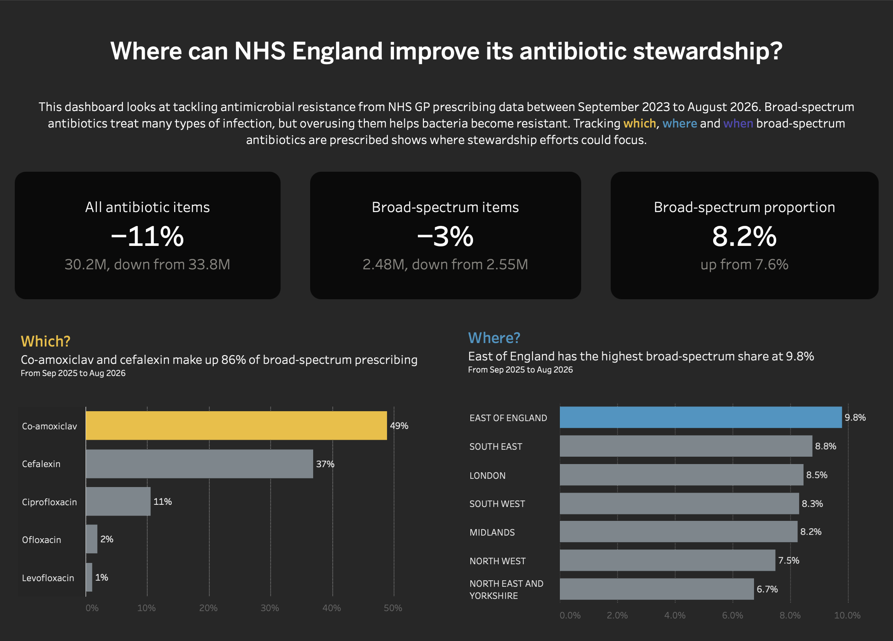
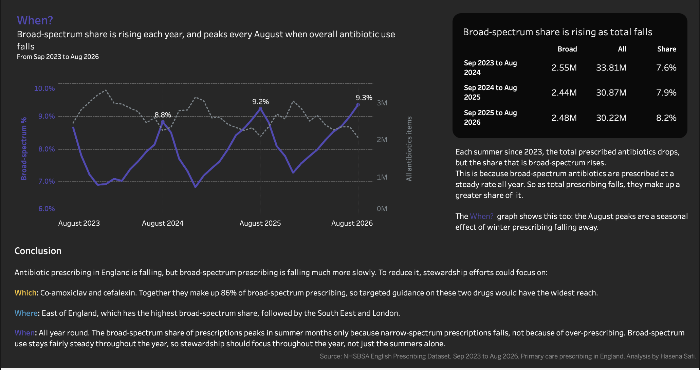

# NHS Antibiotic Prescribing Explorer

An end-to-end data pipeline that extracts antibiotic prescribing data for England from the NHS Business Services Authority (NHSBSA) API, builds bronze, silver and gold layers in DuckDB with SQL, checks the data with automated tests, and feeds a Tableau dashboard.


## About me

I'm a hospital pharmacist, who is keen to move into data engineering. Antimicrobial resistance is something I see the impact of in practice, so I wanted my first pipeline to answer a question I care about professionally.

## What I built and who for

- **As a** hospital pharmacist concerned about antimicrobial resistance,
- **I would like to** find out where NHS England could target its antibiotic stewardship, focusing on the broad-spectrum antibiotics most linked to resistance,
- **therefore I have** built a pipeline that extracts 36 months of primary care antibiotic prescribing (BNF section 5.1) from the NHSBSA API, cleans and tests it, and presents it in a Tableau dashboard,
- **so I can conclude** which broad-spectrum antibiotics, which regions and which times of year stewardship efforts could focus on.

## Dashboard
**[View the interactive dashboard on Tableau Public](https://public.tableau.com/app/profile/hasena.safi/viz/NHSantibiotics/Dashboard1)**




## Findings

**Nationally (Sep 2025 to Aug 2026, compared with Sep 2023 to Aug 2024):**
- Total antibiotic items fell by **11%** (33.8M → 30.2M).
- Broad-spectrum items fell by only **3%** (2.55M → 2.48M).
- So the broad-spectrum share **rose from 7.6% to 8.2%**.

**Which:** co-amoxiclav and cefalexin make up **86%** of broad-spectrum prescribing.

**Where (Sep 2025 to Aug 2026):**

| Region | Broad-spectrum share |
|---|---|
| East of England | 9.8% |
| South East | 8.8% |
| London | 8.5% |
| South West | 8.3% |
| Midlands | 8.2% |
| North West | 7.5% |
| North East and Yorkshire | 6.7% |

**When:** the share peaks every August, but this is because total antibiotic prescribing falls in summer. The number of broad-spectrum prescriptions stays fairly steady all year, so stewardship shouldn't focus on one season alone.


## The data

**Source:** [English Prescribing Dataset (EPD) with SNOMED Code](https://opendata.nhsbsa.net/dataset/english-prescribing-dataset-epd-with-snomed-code), published monthly by NHSBSA under the Open Government Licence. No API key is needed.

**Scope:** antibiotics only (BNF codes starting `0501`), September 2023 to August 2026, by NHS England region.

**Broad-spectrum antibiotics** are defined as co-amoxiclav, cephalosporins and quinolones, the groups monitored in NHS primary care stewardship.

**Why I query the API with SQL instead of downloading files:** each month of the EPD has around 17 million rows. Instead of downloading everything, the extract script sends a SQL query to the portal's `datastore_search_sql` endpoint, so the NHS server filters to antibiotics and adds them up by region. Each month comes back as about 400 rows, and the full extraction takes around a minute.

### Problems I found in the source data

1. **Hidden nesting:** the API wraps results one level deeper than expected (`result.result.records`).
2. **Renamed columns (schema drift):** in older months, `BNF_CHEMICAL_SUBSTANCE` holds the drug *code*; in newer months it holds the drug *name*, and the code moved to `BNF_CHEMICAL_SUBSTANCE_CODE`. The extract script checks each month's columns first and picks the right ones, so codes and names are never mixed up.
3. **Numbers stored as text:** from March 2025, `ITEMS` arrive as text, so the query converts them to numbers before adding them up.
4. **Two month formats:** older months store the month as `202409`, newer months as `'2026-08'`. The silver layer converts both into one date.

## How I explored the data first

Before building the pipeline, I wrote three small scripts in `exploration/` to understand the API. They are not part of the pipeline, but are kept to show how it developed.

- **`exploration/01_test_nhs_api.py`**: checks I can connect to the API and read the dataset's details. It found 70 monthly files, from November 2020 to August 2026.
- **`exploration/02_explore_columns.py`**: asks the API for one row and prints the column names. Comparing an older and a newer month is how I discovered the schema drift.
- **`exploration/03_test_antibiotic_query.py`**: tests sending a SQL query for one month of antibiotics, which is where I found the results are nested one level deeper than expected.

## How it works

The pipeline runs in four stages, from the NHSBSA API to a CSV that Tableau reads:

```
NHSBSA API → data/raw/*.json → bronze → silver → gold → tests → CSV → Tableau
  (extract)     (raw files)       (DuckDB, SQL layers)     (pytest)  (export)
```

### 1. Extract — `src/extract.py`

- Builds the list of months to fetch (September 2023 to August 2026)
- For each month, asks the API for one row to read that month's **column names**, then picks the right code and name columns (handling the schema drift)
- Sends a **SQL query** to the API that:
  - keeps only antibiotics (BNF codes starting `0501`)
  - converts `ITEMS` to numbers
  - calculates **total items** and **total net ingredient cost ()** for each month, region and drug
- **Retries** temporary failures (timeouts, dropped connections, 5xx errors) up to 3 times, waiting 5 then 10 seconds; stops straight away on 4xx errors and logs the server's message. During a real run, the connection dropped on October 2025 and the retry recovered automatically
- Saves each month's response **untouched**, as a timestamped JSON file in `data/raw/`, e.g. `antibiotics_202309_20261110_153412.json`. Files are never overwritten

### 2. Transform — `src/transform.py`

- Opens/creates the database file `data/antibiotics.duckdb`
- Runs every SQL file in `sql/` in number order: bronze, then silver, then gold
- Every layer uses `CREATE OR REPLACE TABLE`, so each run rebuilds from scratch and gives the same result (idempotent)

#### `sql/01_bronze_raw.sql`

- Loads every raw JSON file into one table, `raw_antibiotics`, exactly as it arrived
- Digs into the nested results and turns each record into its own row
- Keeps the **file name**, so later layers know the month and when it was downloaded

```sql
CREATE OR REPLACE TABLE raw_antibiotics AS
SELECT
    filename AS source_file,
    UNNEST(json_extract(json, '$.result.result.records[*]')) AS record
FROM read_json_objects('data/raw/*.json', filename = true);
```

#### `sql/02_silver_staging.sql`

- Unpacks each raw record into clear columns
- Keeps only the **newest download of each month**, so repeated pulls aren't counted twice
- Converts both month formats (`202409` and `'2026-08'`) into one date, e.g. `2024-09-01`
- Sets types: items as whole numbers, cost in pounds to 2 decimal places

```sql
CREATE OR REPLACE TABLE stg_antibiotics AS
WITH parsed AS (
    SELECT
        regexp_extract(source_file, 'antibiotics_(\d{6})_', 1) AS file_month,
        regexp_extract(source_file, 'antibiotics_\d{6}_(\d{8}_\d{6})', 1) AS pulled_at,
        record ->> 'YEAR_MONTH' AS year_month_raw,
        record ->> 'REGIONAL_OFFICE_NAME' AS region,
        record ->> 'bnf_code' AS bnf_code,
        record ->> 'bnf_name' AS bnf_name,
        CAST(record ->> 'total_items' AS DOUBLE) AS items,
    FROM raw_antibiotics
),
latest AS (
    SELECT
        *,
        MAX(pulled_at) OVER (PARTITION BY file_month) AS latest_pull
    FROM parsed
)
SELECT
    CAST(strptime(replace(year_month_raw, '-', ''), '%Y%m') AS DATE) AS month,
    region,
    bnf_code,
    bnf_name,
    CAST(items AS INTEGER) AS items,
    pulled_at
FROM latest
WHERE pulled_at = latest_pull;
```

#### `sql/03_gold_mart.sql`

- Creates the final table, `mart_antibiotics_monthly`: one row per month, region and drug
- Removes rows with region `UNIDENTIFIED` (under 0.1% of items; still kept in silver)
- Adds a **broad-spectrum flag** (TRUE or FALSE): co-amoxiclav (`0501013K0`), cephalosporins (`0501021`) and quinolones (`050112`)
- Holds only values that can be added up (items and cost). Percentages, such as the broad-spectrum share, are calculated in Tableau from the totals, so they're correct at any level

```sql
CREATE OR REPLACE TABLE mart_antibiotics_monthly AS
SELECT
    month,
    region,
    bnf_code,
    bnf_name,
    items,
    (bnf_code LIKE '0501013K0%'
        OR bnf_code LIKE '0501021%'
        OR bnf_code LIKE '050112%') AS is_broad_spectrum
FROM stg_antibiotics
WHERE region <> 'UNIDENTIFIED';
```

### 3. Test — `tests/test_data_quality.py`

Eight checks on the gold table, run with pytest:

- `test_mart_has_rows`: the table isn't empty
- `test_has_36_months`: no month went missing
- `test_has_7_regions`: no region was lost or renamed
- `test_no_duplicate_rows`: each month, region and drug appears once
- `test_no_missing_key_values`: no blanks in month, region, drug code or items
- `test_no_negative_values`: no negative items or cost
- `test_only_antibiotics`: every drug code starts with `0501`
- `test_broad_spectrum_flag_is_set`: every row has a flag, and some are TRUE

### 4. Export — `src/export.py`

- Copies the gold table to `data/exports/mart_antibiotics_monthly.csv`
- Tableau Public can't read a DuckDB file directly, but it can read CSV, so this hands the data to the dashboard
- Opens the database **read-only**, so exporting can never change the data

### Running the pipeline — `src/run.py`

- Runs **transform → test → export** with one command: `python src/run.py`
- Stops if any step fails, so the dashboard never gets untested data
- Extract is left out on purpose: it needs the internet, and the raw files are already committed

### Reproducibility

Raw files are committed, so anyone can clone the repository, install the requirements and rebuild everything without calling the API. Raw files are never overwritten: if NHSBSA corrects a month, re-extracting adds a new file and the silver layer uses the latest one.

### What would need to change at a larger scale

This is intentionally a small, local pipeline. At a larger scale (for example, all prescribing at GP practice level), possible changes would include:

- storing raw files in cloud storage instead of the Git repository
- loading only new months instead of rebuilding the full dataset each run
- moving from a local DuckDB file to a shared cloud database, so a team can use it
- scheduling the pipeline to run automatically after each monthly NHS release
- running the tests automatically, with alerts when one fails
- connecting Tableau directly to the database instead of a CSV export

The bronze, silver and gold design, the SQL logic and the tests would stay the same.

## Decisions

- **Rows with region `UNIDENTIFIED` are kept in silver but excluded from gold.** They can't be linked to a region and are under 0.1% of items.
- **One gold table with a flag**, rather than separate tables for each measure. Percentages are calculated in Tableau from the totals, so they're always correct at any level of detail.
- **Region level, not GP practice level**, to keep the extraction small and the story clear.

## How to run it

```bash
git clone https://github.com/hasenasafi/nhs-antibiotic-explorer.git
cd nhs-antibiotic-explorer
python3 -m venv .venv
source .venv/bin/activate
pip install -r requirements.txt

python src/run.py              # rebuilds the database from the committed raw files, tests it and exports the CSV

# optional, needs internet: refresh the raw data from the API
python src/extract.py
```

## Project structure

```
data/raw/        raw JSON responses from the API (bronze source)
data/exports/    CSV for Tableau
docs/            dashboard screenshots
exploration/     early scripts used to explore the API
sql/             bronze, silver and gold SQL layers
src/             extract, transform, export and run scripts
tests/           data-quality tests
```

## Limitations

**Of the data**
- **Items are not patients.** One patient can receive several items, so the figures measure prescribing volume, not people treated.
- **Not adjusted for population.** Regions differ in size, age and deprivation. The broad-spectrum *share* allows fair comparison, but total volumes don't.
- **A higher share isn't automatically poor prescribing**: it can reflect local resistance patterns and patient mix.
- **Not all antibiotic supply is captured.** The EPD excludes medicines supplied under Patient Group Directions (including Pharmacy First), dental prescribing, and some hospital prescribing.

**Of the pipeline**
- **Manual refresh.** The date range is fixed in `extract.py`, so new months need a manual change and rerun.
- **Full rebuild.** Every run rebuilds all months from scratch. That's simple and quick at this size, but wouldn't suit a much larger dataset.
- **Fixed dashboard dates.** The dashboard uses a fixed date range, so it doesn't update itself when new data arrives.

## What I would do next

- **Make the latest month dynamic:** read the most recent available month from the API instead of a fixed end date, and only download months not already saved.
- **Switch the dashboard to live data:** use relative date filters (such as "last 12 months") and a refreshing data source, instead of a fixed date range.
- Schedule the extraction to run automatically after each monthly NHS release.
- Add GP registered-patient numbers to compare antibiotic items per 1,000 patients, the key measure for identifying overprescribing.
- Extend the data back to 2020 to see the long-term trend, taking care with the COVID years.
- Break down to Integrated Care Board (ICB) level for a more local view.

## Where AI helped

I used Claude as a tutor throughout. It explained concepts, suggested code that I ran and debugged step by step, and helped me investigate the data problems above. I chose the topic and scope, made the decisions in this README, checked the results (through reconciliation checks and the test suite), and designed the dashboard with feedback from my mentor.
