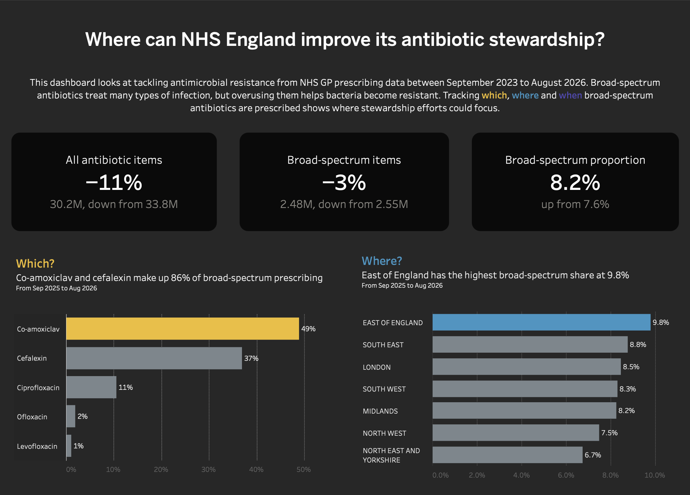
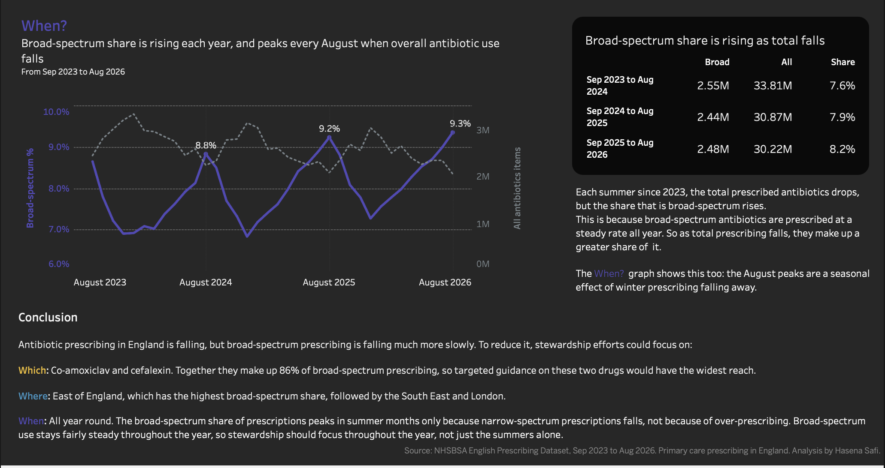

# NHS Antibiotic Prescribing Explorer

An end-to-end data pipeline that extracts antibiotic prescribing data for England from the NHS Business Services Authority (NHSBSA) API, builds it into DuckDB through bronze, silver and gold SQL layers, checks it with automated data-quality tests, and feeds a Tableau dashboard.

**[View the interactive Tableau dashboard](https://public.tableau.com/app/profile/hasena.safi/viz/NHSantibiotics/Dashboard1)**

## About me

I'm a hospital pharmacist moving into data engineering. Antimicrobial resistance is one of the biggest problems I see in practice, so I built this project around a question pharmacists and stewardship teams care about.

## What I built and who for

- **As a** hospital pharmacist concerned about antimicrobial resistance,
- **I would like to** find where NHS England could target its antibiotic stewardship, focusing on the broad-spectrum antibiotics most linked to resistance,
- **therefore I have used** the NHSBSA Open Data Portal API to extract three years of antibiotic prescribing (BNF section 5.1) and built a pipeline that loads, cleans, tests and serves it to Tableau,
- **so I can conclude** which broad-spectrum antibiotics, which regions and which times of year stewardship efforts could focus on.

## Dashboard




## Findings

- **Antibiotic prescribing is falling, but broad-spectrum prescribing is falling much more slowly.** Over two years, total antibiotic items fell by 11% (33.8M to 30.2M a year) but broad-spectrum items fell by only 3% (2.55M to 2.48M), so the broad-spectrum share rose from 7.6% to 8.2%.
- **Which:** co-amoxiclav and cefalexin make up 86% of broad-spectrum prescribing (Sep 2025 to Aug 2026).
- **Where:** East of England has the highest broad-spectrum share (9.8%) and North East and Yorkshire the lowest (6.7%).
- **When:** the share peaks every August (8.8%, 9.2%, 9.3%), but only because total antibiotic use falls in summer. The number of broad-spectrum prescriptions stays fairly steady all year, so stewardship should focus throughout the year, not just the summer alone.

## The data

**Source:** [English Prescribing Dataset (EPD) with SNOMED Code](https://opendata.nhsbsa.net/dataset/english-prescribing-dataset-epd-with-snomed-code), published monthly by NHSBSA under the Open Government Licence. No API key is needed.

**Scope:** antibiotics only (BNF codes starting `0501`), September 2023 to August 2026 (36 months), by NHS England region.

**Why I query the API with SQL instead of downloading files:** each month of the EPD has around 17 million rows. Instead of downloading everything, the extract script sends a SQL query to the portal's `datastore_search_sql` endpoint, so the NHS server filters to antibiotics and adds them up by region. Each month comes back as about 400 rows, and the full extraction takes about a minute.

## How I explored the data first

Before building the pipeline, I wrote three small scripts (in `exploration/`) to understand the API:

1. `01_test_nhs_api.py`: checked I could connect to the API, and found 70 monthly files available (November 2020 to August 2026).
2. `02_explore_columns.py`: listed each month's column names. Comparing an older and a newer month is how I discovered the NHS had renamed its columns (schema drift).
3. `03_test_antibiotic_query.py`: tested sending a SQL query to the API for one month of antibiotics, which is where I found the results were nested one level deeper than expected.

### Problems I found in the source data

1. **Hidden nesting:** the SQL endpoint wraps results one level deeper than expected (`result.result.records`).
2. **Renamed columns (schema drift):** in older months `BNF_CHEMICAL_SUBSTANCE` holds the drug *code*; in newer months it holds the drug *name*, and the code moved to `BNF_CHEMICAL_SUBSTANCE_CODE`. The extract script checks each month's columns first and picks the right ones, so codes and names are never mixed up.
3. **Numbers stored as text:** from March 2025, `ITEMS` and `NIC` arrive as text, so the query converts them with `CAST(... AS FLOAT64)` before adding them up.
4. **Two month formats:** older months store the month as `202409`, newer months as `'2026-08'`. The silver layer converts both into a proper date.

## How it works

```
NHSBSA API →     data/raw/*.json →   bronze → silver → gold →    tests →    CSV → Tableau
  (extract)       (raw files)        └─── DuckDB (SQL) ───┘     (pytest)      (export)
```

1. **Extract** (`src/extract.py`): loops over the months, detects each month's column layout, queries the API, and saves each response untouched as a timestamped JSON file in `data/raw/`. It retries temporary failures (timeouts, 5xx errors) with increasing waits, stops immediately on 4xx errors (a bad request won't fix itself), and logs the server's error message. During a real run the connection dropped once, and the retry recovered automatically.
2. **Bronze** (`sql/01_bronze_raw.sql`): loads every raw file into DuckDB as it arrived, one row per record, tagged with its source file.
3. **Silver** (`sql/02_silver_staging.sql`): keeps only the newest download of each month (raw files are never overwritten, so a month can be pulled more than once), converts the two month formats into one date, and sets clear names and types.
4. **Gold** (`sql/03_gold_mart.sql`): the analysis-ready table `mart_antibiotics_monthly`, one row per month, region and drug, with a TRUE/FALSE broad-spectrum flag (co-amoxiclav, cephalosporins and quinolones).
5. **Tests** (`tests/test_data_quality.py`): 8 checks on the gold table: it has rows, 36 months, 7 regions, no duplicates, no missing key values, no negative values, antibiotics only, and the broad-spectrum flag is set.
6. **Export** (`src/export.py`): writes the gold table to `data/exports/mart_antibiotics_monthly.csv` for Tableau.

`src/transform.py` runs the three SQL layers in order, and `src/run.py` runs the whole pipeline (transform → test → export) in one command. If a test fails, the pipeline stops, so Tableau never gets untested data.

**Idempotent:** every SQL layer uses `CREATE OR REPLACE TABLE` and rebuilds from all the raw files, so running the pipeline twice gives the same result.

**Reproducible:** the raw JSON files are committed, so anyone can rebuild the database and dashboard data without calling the API.

## Decisions

- **Bronze, silver and gold layers** keep raw data, cleaning and analysis separate, so any problem can be traced back to where it started.
- **DuckDB** because it's a database in a single file with no server to set up, reads JSON directly, and handles this data size easily on a laptop.
- **One gold table with a flag, ratios in Tableau.** The gold table holds only values that can be added up (items and cost). Percentages are calculated in Tableau from the totals, so they're always correct at any level and percentages are never averaged.
- **Rows with region `UNIDENTIFIED` are kept in silver but excluded from gold.** They can't be shown on a regional chart and are under 0.1% of items.
- **Broad-spectrum definition** follows the national primary care indicator: co-amoxiclav, cephalosporins and quinolones.

## Project structure

```
nhs-antibiotic-explorer/
├── data/
│   ├── raw/          # raw JSON from the API (bronze source, committed)
│   └── exports/      # CSV for Tableau
├── docs/             # dashboard screenshots
├── exploration/      # early scripts, kept to show how the pipeline developed
├── sql/              # 01_bronze_raw, 02_silver_staging, 03_gold_mart
├── src/              # extract, transform, export, run
├── tests/            # data-quality tests
└── requirements.txt
```

## How to run it

```bash
git clone https://github.com/hasenasafi/nhs-antibiotic-explorer.git
cd nhs-antibiotic-explorer
python3 -m venv .venv
source .venv/bin/activate
pip install -r requirements.txt

python src/run.py              # rebuild the database, run the tests, export the CSV

# optional, needs internet: download fresh data from the API first
python src/extract.py
```

## Limitations

**Of the data**
- **Items are not patients.** One patient can receive several items, so the figures measure prescribing volume, not people treated.
- **Not adjusted for population.** Regions differ in size, age and deprivation. The broad-spectrum *share* allows fair comparison, but total volumes don't.
- **A higher share isn't automatically poor prescribing**: it can reflect local resistance patterns and patient mix.
- **Not all antibiotic supply is captured.** The EPD excludes medicines supplied under Patient Group Directions (including Pharmacy First), dental prescribing, and some hospital prescribing.

**Of the pipeline**
- **Manual refresh.** The date range is fixed in `extract.py`, so new months need a manual change and rerun.
- **Full rebuild.** Every run rebuilds all months from scratch. That's simple and quick at this size, but wouldn't suit a much larger dataset.

## What I would do next

- Add GP registered-patient numbers to compare antibiotic items per 1,000 patients, the key measure for identifying overprescribing.
- Extend the data back to 2020 for a longer-term trend, taking care with the COVID years.
- Schedule the extraction to run monthly and only fetch new months (incremental loading).
- Break down to Integrated Care Board (ICB) level for a more local view.
- Make extraction automatic: read the latest available month from the API, only download new months, and schedule a run after each monthly NHS release.

## Where AI helped

I used Claude as a tutor while building this. It explained concepts, suggested code that I ran, tested and debugged step by step, and helped me investigate the data problems listed above. I chose the topic and scope, made the decisions in this README, designed the dashboard, and verified the results (reconciling row counts between layers, checking Tableau figures against SQL, and sense-checking the drug list as a pharmacist).